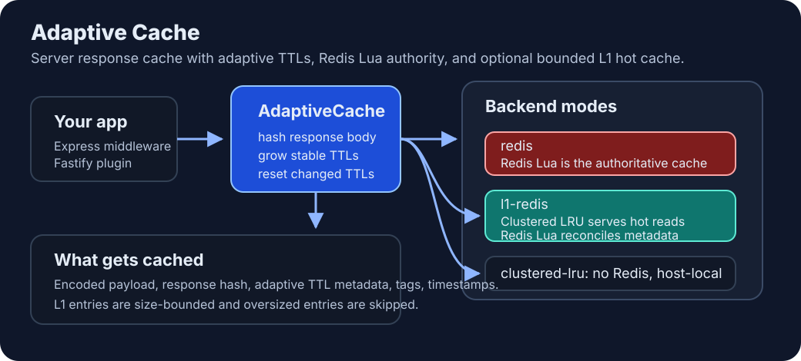

# @0xdoublesharp/adaptive-cache

[](https://www.npmjs.com/package/@0xdoublesharp/adaptive-cache)
[](https://npm-stat.com/charts.html?package=%400xdoublesharp%2Fadaptive-cache)
[](https://github.com/doublesharp/adaptive-cache/actions?query=workflow%3ACI+branch%3Amain)
[](https://doublesharp.github.io/adaptive-cache/coverage/)
[](https://github.com/doublesharp/adaptive-cache/blob/main/LICENSE)

Server-side caching with TTLs that adapt to how often your data changes.

Use `@0xdoublesharp/adaptive-cache` with Express, Fastify, or directly in application code. It compares content hashes, increases TTLs when data stays the same, and resets them when data changes.

Redis is the default backend. Add a bounded LRU layer to keep hot payloads in memory, or use clustered LRU alone for a single server or Node cluster. Redis-backed modes provide atomic write and refresh-lock checks across hosts. Clustered LRU has weaker coordination guarantees and keeps state on one host.

Use middleware for response caching and `getOrSet` for expensive work that needs concurrent request coalescing, stale refresh, or negative caching. Background refresh requires an explicit loader. The cache honors HTTP storage restrictions but does not generate `Cache-Control` headers.

See the [feature guide](docs/cache-features.md) for detailed policies and the [upgrade guide](docs/releases.md) before changing an existing deployment.

## Installation

Requires Node.js 22 or newer.

Install the package:

```bash
pnpm add @0xdoublesharp/adaptive-cache
```

Install the framework you use:

```bash
pnpm add express
pnpm add fastify
```

For either LRU-backed mode, also install:

```bash
pnpm add @0xdoublesharp/lru-cache-clustered lru-cache@^11
```

Redis-only applications do not need these peers or either HTTP framework. Public CJS/ESM imports load optional peers only when needed. Check [package.json](package.json) for supported runtime and peer ranges.

## Express

```typescript
import express from 'express'
import { adaptiveExpressCache } from '@0xdoublesharp/adaptive-cache'

const app = express()

app.get(
  '/api/items',
  adaptiveExpressCache({
    initialTTL: 10,
    maxTTL: 3600,
    ttlScaling: 1.5,
    includeDebugHeaders: true,
  }),
  async (_req, res) => {
    const items = await loadItems()
    res.json(items)
  },
)
```

### Dynamic `maxTTL`

`maxTTL` can be a function. Middleware resolves it after your handler returns.

```typescript
app.get(
  '/api/items/:id',
  adaptiveExpressCache({
    initialTTL: 60,
    maxTTL: (data) => (data.status === 'ended' ? 86400 : 300),
  }),
  async (req, res) => {
    res.json(await loadItem(req.params.id))
  },
)
```

### Tags

Tags can be static or request-derived.

```typescript
const users = adaptiveExpressCache({
  tags: (req) => [`user:${req.params.id}`, 'users'],
})
app.get('/api/users/:id', users, async (req, res) => {
  res.json(await loadUser(req.params.id))
})

await users.cache.invalidateTags(['users'])
await users.clear({
  originalUrl: '/api/users/123',
  query: {},
  headers: { host: 'api.example:8080' },
})
```

Default keys include lowercased request authority, including its port, plus path and normalized query. Include the original Host header when clearing. `.clear(request)` also reproduces custom keys and header variations on the same cache instance.

For a default key, the legacy helper accepts authority as an optional fifth argument:

```typescript
import { clearAdaptiveCache } from '@0xdoublesharp/adaptive-cache'

await clearAdaptiveCache('/api/users/123', {}, 'adaptive:', {}, 'api.example:8080')
```

Omitting authority clears the legacy key format. Use the adapter's `.clear(request)` for injected caches, custom keys, or `varyBy`. Each default adapter owns its cache; `getDefaultCache()` is a separate process-wide helper instance.

## Fastify

```typescript
import Fastify from 'fastify'
import { adaptiveFastifyCache } from '@0xdoublesharp/adaptive-cache'

const fastify = Fastify()

await fastify.register(
  adaptiveFastifyCache({
    backend: 'l1-redis',
    initialTTL: 10,
    maxTTL: 3600,
    ttlScaling: 1.5,
    includeDebugHeaders: true,
    lru: {
      namespace: 'fastify-api',
      maxSizeBytes: 64 * 1024 * 1024,
    },
  }),
)

fastify.get('/api/summary', async () => {
  return await loadSummary()
})
```

Await adapter registration before declaring cached Fastify routes. Cache lookups and loaders run after validation and authorization hooks. Earlier routes remain uncached. A registration prefix limits caching to matching paths in that scope. See [HTTP identity and ownership](docs/cache-features.md#http-identity-and-ownership).

## Direct API

Use `AdaptiveCache` in jobs, services, or other code outside an HTTP handler.

```typescript
import { AdaptiveCache } from '@0xdoublesharp/adaptive-cache'

const cache = new AdaptiveCache({
  backend: 'l1-redis',
  includeDebugHeaders: true,
  lru: { namespace: 'jobs' },
})

await cache.set('adaptive:job:summary', { total: 42 }, { tags: ['jobs'] })

const hit = await cache.get<{ total: number }>('adaptive:job:summary')
if (hit) {
  console.log(hit.data, hit.ttl, hit.metadata)
}

await cache.flush()
await cache.close()
```

Direct API keys are complete keys. `keyPrefix` selects coordination and invalidation state but does not prepend text to a direct key. Middleware constructs prefixed keys automatically.

Direct API calls preserve JSON values, strings, buffers, and `undefined` in a cache envelope. Middleware caches eligible successful GET responses with their status, selected headers, and original body. JSON-looking text and binary responses retain their representation on a hit. Other methods and Node/WHATWG streams bypass caching. HTTP loaders normalize binary views to buffers. Native responses and other unsupported objects bypass storage and result sharing, so each request receives its own source result. HTTP 404 responses require an explicit `negativeTTL`.

### Coalesced loading and stale refresh

```typescript
const cache = new AdaptiveCache({
  keyPrefix: 'catalog:',
  initialTTL: 10,
  maxTTL: 300,
  staleWhileRevalidate: 30,
  staleIfError: 120,
  ttlJitter: 0.1,
  compression: { minBytes: 1024, async: true, skipCompressed: true, onlyIfSmaller: true },
})

const product = await cache.getOrSet('catalog:product:42', () => loadProduct('42'), {
  tags: ['products'],
  negativeTTL: 5,
})
const hits = await cache.getMany(['catalog:product:42', 'catalog:product:43'])
await cache.invalidateTags(['products'])
await cache.invalidateNamespace()
await cache.close()
```

`getMany()` uses batched payload and primary invalidation checks on clustered LRU. Results and events remain per key. Bulk operations are not transactions.

Stale windows are measured independently from freshness expiry. Plain `get()` returns fresh entries only; `get(key, { allowStale: true })` exposes retained stale data. Negative entries have no stale window. See the [feature guide](docs/cache-features.md) for force-refresh behavior, events, fingerprints, bulk operations, and custom backend limits.

Each `getOrSet` caller has a 30000ms deadline by default. Configure `loadTimeoutMs` or pass a caller `signal` to change it. Loaders receive a shared `{ signal }`; one caller timing out does not cancel work another caller still needs. HTTP deadlines also cover cache reads, bypassed loaders, and fallback waits. Source errors retain their original identity.

`close()` drains work within a 5000ms default deadline, then aborts loaders and requests forced teardown. Configure `closeTimeoutMs` or pass `close({ timeoutMs })`. Expiry rejects with `TimeoutError`. See [loader lifetime](docs/cache-features.md#bound-loader-lifetime) and [shutdown](docs/cache-features.md#observe-and-drain-work).

### HTTP identity and response policy

Range and If-Range requests bypass caching, and partial `206` responses are not stored. Authorization and Cookie requests bypass caching unless explicitly enabled with a key or variation that isolates the caller. Responses with `Cache-Control: private` or `no-store`, `Set-Cookie`, `Vary: *`, or undeclared `Vary` headers are excluded. Declare `varyBy: ['Accept-Encoding']` when compression middleware adds that response header.

```typescript
const products = adaptiveExpressCache({
  keyPrefix: 'catalog:',
  key: (req) => `product:${req.params?.id}`,
  varyBy: ['Accept-Language'],
  loader: (req) => loadProduct(req.params?.id),
  staleWhileRevalidate: 30,
})
app.get('/products/:id', products)

// Stop accepting requests before closing the cache.
await products.close()
```

Default adapters own their caches and connections. Fastify accepts the same policy options and closes owned caches in its `onClose` hook. Both adapters accept `cache` to reuse a caller-owned instance. Keep that instance's namespace aligned with the middleware prefix. Use `products.clear(request)` to invalidate a response using the same custom key and header variations as the adapter. See [HTTP identity and ownership](docs/cache-features.md#http-identity-and-ownership).

### Generic function caching

`cacheResult` is a simple Redis helper for non-adaptive function results. It uses the default Redis client directly and does not use the adaptive backend layer.

```typescript
import { cacheResult } from '@0xdoublesharp/adaptive-cache'

const data = await cacheResult('expensive-report', 60, async () => {
  return await buildReport()
})
```

### Refresh locks

Refresh locks let one worker rebuild a resource while others wait or use cached data.

```typescript
import { releaseCacheRefreshLock, shouldRefreshCache } from '@0xdoublesharp/adaptive-cache'

const result = await shouldRefreshCache('report:last-update', 60)

if (result[0] === 'UPDATE') {
  const lockValue = result[1]
  try {
    await rebuildReport()
  } finally {
    await releaseCacheRefreshLock('report:last-update', lockValue)
  }
}
```

`lockExpirationSeconds` defaults to `60`. You can set a process-wide default:

```typescript
import { setDefaultLockExpirationSeconds } from '@0xdoublesharp/adaptive-cache'

setDefaultLockExpirationSeconds(120)
```

Or pass a per-call value:

```typescript
await shouldRefreshCache('report:last-update', 60, false, 120)
```

## Architecture



## Backend modes

| Backend         | Redis required | Best for                                | Behavior                                                           |
| --------------- | -------------- | --------------------------------------- | ------------------------------------------------------------------ |
| `redis`         | Yes            | Default production mode                 | Redis Lua stores data, metadata, tags, and locks.                  |
| `l1-redis`      | Yes            | Production hot paths                    | Clustered LRU serves hot reads; Redis Lua remains authoritative.   |
| `clustered-lru` | No             | Single-server or one-host Node clusters | Volatile bounded cache with adaptive TTL logic in process/cluster. |
| custom backend  | Depends        | Advanced integrations                   | Provide the `AdaptiveCacheBackend` interface.                      |

### `redis`

The default backend stores payloads and metadata in Redis. Lua scripts handle atomic updates, refresh locks, and invalidation.

```typescript
import { adaptiveExpressCache } from '@0xdoublesharp/adaptive-cache'

app.get('/api/summary', adaptiveExpressCache(), handler)
```

### `l1-redis`

Use this to keep hot payloads in bounded memory while Redis controls freshness and invalidation. Each L1 hit still requires a Redis validation round trip.

```typescript
import { adaptiveExpressCache } from '@0xdoublesharp/adaptive-cache'

app.get(
  '/api/summary',
  adaptiveExpressCache({
    backend: 'l1-redis',
    initialTTL: 5,
    maxTTL: 900,
    lru: {
      namespace: 'api-cache',
      maxSizeBytes: 64 * 1024 * 1024,
      maxEntrySizeBytes: 6 * 1024 * 1024,
    },
  }),
  handler,
)
```

Read path:

1. Read Redis invalidation controls and the entry revision, then check clustered LRU.
2. On a valid L1 hit, return the local payload. Validation Lua reads and decodes the Redis envelope to detect older writers, but does not transfer it to Node.
3. On L1 miss, fetch from Redis Lua.
4. On Redis hit, hydrate L1 with Redis remaining TTL and metadata.
5. On Redis miss, continue to the handler.

Write path:

1. Encode/compress once and hash the response.
2. Store in L1 immediately with `initialTTL`.
3. Run Redis Lua update asynchronously.
4. When Redis returns, reconcile L1 with Redis' authoritative adaptive TTL and metadata.
5. If Redis update fails, log the failure. The unconfirmed L1 entry cannot qualify as an authoritative hit.

Use `l1Redis.writeMode: 'await-redis'` to wait for Redis before `set()` resolves, or call `cache.flush()` before process shutdown to wait for pending async Redis writes.

Loader writes, middleware writes, and asynchronous compression wait for Redis to accept their write token. Ordinary synchronous `set()` calls retain the optimistic write path above. Every L1 hit validates its invalidation state and durable entry revision against Redis, even after a missed Pub/Sub message or a write whose fingerprint stayed the same. Unconfirmed optimistic entries fall through to Redis. Keep this round trip in mind when comparing L1 and Redis-only latency.

Invalidation:

- Explicit clears drain pending writes on the shared Redis client, delete Redis data, drain active L1 hydrations, remove L1 entries, then publish an invalidation message.
- Reads that overlap an invalidation cannot hydrate an older snapshot back into L1.
- Tag invalidation removes matching L1 entries and Redis entries.
- Every accepted Redis write changes the entry revision. Pub/Sub accelerates invalidation; L1 validation also detects writes without it.
- Other server-local L1 caches subscribe to Redis invalidation messages and delete stale keys.
- Namespace and write barriers prevent invalidated in-flight work from becoming a later cache hit.

Refresh locks use Redis Lua for cross-host coordination.

### `clustered-lru`

Use this for a single process or one-host Node cluster that needs a bounded cache without Redis.

```typescript
import { adaptiveFastifyCache } from '@0xdoublesharp/adaptive-cache'

await fastify.register(
  adaptiveFastifyCache({
    backend: 'clustered-lru',
    initialTTL: 5,
    maxTTL: 300,
    lru: {
      namespace: 'api-cache',
      maxSizeBytes: 64 * 1024 * 1024,
    },
  }),
)
```

Adaptive metadata stays in separate bounded LRU entries for `metaTTL`, allowing unchanged data to increase its TTL after the payload expires. All state is volatile and local to the host.

Lock acquisition is atomic on the cluster primary. Release checks the lock value before deleting it, but those operations are separate and can race with lock replacement. Use a Redis-backed mode when strict refresh coordination is required.

## LRU memory limits

`l1-redis` and `clustered-lru` store an envelope in clustered LRU:

- Encoded payload.
- Response hash.
- Adaptive metadata: `dataTTL`, `lastChanged`, `changeCount`.
- Created/updated timestamps.
- Expiration timestamp.
- Tags.

Defaults:

| Option                  | Default               | Description                                          |
| ----------------------- | --------------------- | ---------------------------------------------------- |
| `lru.maxSizeBytes`      | `64 * 1024 * 1024`    | Total LRU size budget.                               |
| `lru.maxEntrySizeBytes` | 10% of `maxSizeBytes` | Entries larger than this are skipped for L1 storage. |
| `lru.timeout`           | package default       | Clustered LRU operation timeout.                     |
| `lru.failsafe`          | `'reject'`            | Clustered LRU failure behavior.                      |
| `lru.namespace`         | `'adaptive-cache'`    | Shared cache namespace.                              |

Entry size is estimated as encoded payload bytes plus tag metadata and a small fixed metadata overhead. TTLs passed to clustered LRU are milliseconds; adaptive cache options use seconds.

## Per-worker L1 caching

Set `lru.localL1` to keep a small cache inside each worker, in front of the cluster primary. The options pass through to `@0xdoublesharp/lru-cache-clustered`.

```typescript
adaptiveExpressCache({
  backend: 'l1-redis',
  lru: {
    namespace: 'api-cache',
    maxSizeBytes: 64 * 1024 * 1024,
    localL1: {
      enabled: true,
      experimental: true,
      ttl: 2_000,
      maxSize: 4 * 1024 * 1024,
      invalidation: 'broadcast',
      methods: {
        get: true,
        has: true,
        fetch: true,
        memoize: true,
      },
    },
  },
})
```

Use `localL1: true` for the dependency's default local-cache settings.

## Configuration

| Option                  | Type                                                               | Default       | Description                                                                           |
| ----------------------- | ------------------------------------------------------------------ | ------------- | ------------------------------------------------------------------------------------- |
| `initialTTL`            | `number`                                                           | `5`           | Starting cache duration in seconds.                                                   |
| `maxTTL`                | `number \| (data) => number \| undefined`                          | `900`         | Maximum data TTL in seconds. Middleware can resolve it from response data.            |
| `ttlScaling`            | `number`                                                           | `2`           | Factor used to grow TTL when content is unchanged. Growth is damped by `changeCount`. |
| `redisPrefix`           | `string`                                                           | `'adaptive:'` | Prefix for Redis keys and invalidation channels.                                      |
| `keyPrefix`             | `string`                                                           | unset         | Clearer alias for `redisPrefix`; applies to Redis and non-Redis backends.             |
| `includeHeaders`        | `boolean`                                                          | `true`        | Add `X-Cache` and `X-Cache-TTL`.                                                      |
| `includeDebugHeaders`   | `boolean`                                                          | `false`       | Add adaptive metadata headers.                                                        |
| `forceRefresh`          | `boolean`                                                          | `false`       | Bypass existing cache reads and refresh after the handler response.                   |
| `lockExpirationSeconds` | `number`                                                           | `60`          | Refresh lock expiration in seconds.                                                   |
| `metaTTL`               | `number`                                                           | `604800`      | Metadata/tag TTL in positive integer seconds.                                         |
| `compress`              | `boolean`                                                          | `true`        | Gzip payloads and store them as base64.                                               |
| `logLevel`              | `'debug' \| 'info' \| 'warn' \| 'error' \| 'silent'`               | `'info'`      | Logger verbosity.                                                                     |
| `backend`               | `'redis' \| 'l1-redis' \| 'clustered-lru' \| AdaptiveCacheBackend` | `'redis'`     | Cache backend.                                                                        |
| `lru`                   | `AdaptiveCacheLruOptions`                                          | unset         | LRU options for `l1-redis` and `clustered-lru`.                                       |
| `l1Redis.writeMode`     | `'async' \| 'await-redis'`                                         | `'async'`     | Whether `l1-redis` returns after L1 write or waits for Redis reconciliation.          |
| `ignoreQueryParams`     | `string[]`                                                         | `['refresh']` | Query parameters excluded from middleware cache-key hashes.                           |

Additional options shared by the cache and adapters:

| Option                         | Default | Purpose                                                                                        |
| ------------------------------ | ------- | ---------------------------------------------------------------------------------------------- |
| `staleWhileRevalidate`         | `0`     | Seconds after freshness expiry during which a loader can refresh in the background.            |
| `staleIfError`                 | `0`     | Independent seconds after freshness expiry during which a failed loader may return stale data. |
| `negativeTTL`                  | `0`     | Opt-in TTL for null/undefined loader results or normal-handler HTTP 404 responses.             |
| `lockWaitTimeoutMs`            | `5000`  | Maximum loader lock wait in milliseconds.                                                      |
| `ttlJitter`                    | `0`     | Fraction from 0 to 1 by which to randomly shorten freshness.                                   |
| `fingerprint` / `ignoreFields` | unset   | Custom content fingerprint or dotted fields excluded from the hash.                            |
| `compression`                  | unset   | `minBytes`, `async`, `skipCompressed`, and `onlyIfSmaller` selective codec settings.           |
| `onEvent`                      | unset   | Observer for cache activity; also available through `cache.onEvent()`.                         |

`loadTimeoutMs` defaults to `30000` milliseconds and `closeTimeoutMs` to `5000` milliseconds. Deadline options accept values from `0` through `2147483647`; per-call options override instance defaults.

HTTP-only options are `cache`, `loader`, `key`, `varyBy`, `shouldCache`, `cacheAuthenticated`, `cacheCookies`, and request-derived `tags`. Defaults bypass authenticated/cookie requests and use authority, path, and query keys. Custom keys must provide authority or tenant isolation. See the [feature guide](docs/cache-features.md) for examples and per-call overrides.

## Headers

| Header                  | Meaning                                                                |
| ----------------------- | ---------------------------------------------------------------------- |
| `X-Cache: HIT`          | Cached response returned.                                              |
| `X-Cache: MISS`         | No cache entry; handler ran.                                           |
| `X-Cache: BYPASS`       | Cache read skipped because `forceRefresh` or `?refresh=true` was used. |
| `X-Cache: RETRY`        | Cache read/decode failed; handler ran without failing the request.     |
| `X-Cache-TTL`           | Remaining data TTL in seconds.                                         |
| `X-Cache-Data-TTL`      | Debug: adaptive TTL assigned to the data version.                      |
| `X-Cache-Last-Modified` | Debug: Unix timestamp when content last changed, or `unknown`.         |
| `X-Cache-Refreshed`     | Debug: content change count.                                           |

## Redis keys and Lua metadata

Given an adaptive key, this package uses:

- `${key}data`: versioned Redis envelope containing encoded payload, freshness, namespace generation, tags, and tag epochs.
- `${key}data:state`: auxiliary freshness and tag membership state.
- `${key}meta`: adaptive metadata hash.
- `${key}data:revision`: durable revision checked on L1 reads.
- `${redisPrefix}__adaptive:tag-index:${tag}`: expiry-scored tag membership index.
- `${redisPrefix}tag:${tag}`: legacy tag set supported during cleanup.
- `${redisPrefix}l1:invalidate`: Redis Pub/Sub channel for L1 invalidations.
- `${lastUpdateKey}-lock`: refresh lock key.
- `${redisPrefix}__adaptive:namespace`, `${redisPrefix}__adaptive:barrier`, and `${redisPrefix}__adaptive:tag-epoch:${tag}`: invalidation control keys.
- `__adaptive:legacy-barrier`: shared barrier for clears without namespace information.

Lua fetch returns:

```text
[data, remainingTTL, dataTTL, lastChanged, changeCount, hash, staleFlag, staleAgeMs, revision]
```

Lua update returns:

```text
['CACHED', dataTTL, lastChanged, changeCount, hash, changedFlag]
```

The public hit reports `staleAge` in seconds. A rejected write returns `['INVALIDATED', 0]`. Treat the Redis envelope and Lua results as internal formats. Follow the [upgrade guide](docs/releases.md) when changing readers or writers.

## TTL policies

The default policy increases TTL for unchanged content and resets it when content changes. Opt into additive increase/multiplicative decrease with `ttlPolicy: { type: 'aimd' }`, or time-aware smoothing with `ttlPolicy: { type: 'ewma' }`. Both are available on all built-in backends. See [TTL policies](docs/ttl-policies.md) for parameters, formulas, and observation limits.

## Default adaptive TTL formula

On changed content:

- `changeCount += 1`
- `dataTTL = min(initialTTL, maxTTL)`
- `lastChanged = now`

On unchanged content:

- If `dataTTL >= maxTTL`, keep `maxTTL`.
- Otherwise compute a damped increase:

```text
decayFactor = 1.0 - min(0.9, changeCount * 0.01)
increaseFactor = max(0, ttlScaling - 1)
increase = ceil(floor(dataTTL * increaseFactor) * decayFactor)
dataTTL = max(initialTTL, min(dataTTL + increase, maxTTL))
```

After either path, clamp `dataTTL` to `maxTTL`. Optional jitter shortens freshness; stale retention extends physical storage without extending the fresh TTL.

## Environment variables

| Variable                        | Description                                                       |
| ------------------------------- | ----------------------------------------------------------------- |
| `REDIS_TLS_URL`                 | Preferred Redis TLS connection string.                            |
| `REDIS_URL`                     | Redis connection string. Used when `REDIS_TLS_URL` is not set.    |
| `REDIS_HOST`                    | Redis host fallback. Defaults to `localhost`.                     |
| `REDIS_PORT`                    | Redis port fallback. Defaults to `6379`.                          |
| `REDIS_TLS_REJECT_UNAUTHORIZED` | Set to `false` to disable Redis TLS certificate verification.     |
| `REDIS_INSECURE_TLS`            | Set to `true` to disable Redis TLS certificate verification.      |
| `CACHE_TIME`                    | Default duration string for `cache()`, for example `"5 seconds"`. |

TLS options are applied only for `REDIS_TLS_URL` or `rediss://` URLs. Certificate verification is enabled by default.

## Custom backends

Advanced users can provide a backend object instead of a backend name.

```typescript
import type { AdaptiveCacheBackend } from '@0xdoublesharp/adaptive-cache'

const backend: AdaptiveCacheBackend = {
  name: 'custom',
  async fetch(input) {
    return null
  },
  async update(input) {
    return ['CACHED', input.initialTTL]
  },
  async clear(key, dataKey, metaKey) {},
  async invalidateTags(tags, redisPrefix) {
    return []
  },
  async shouldRefresh(lastUpdateKey, refreshThreshold, currentTime, force, lockExpirationSeconds, lockValue) {
    return ['UPDATE', lockValue]
  },
  async releaseLock(lastUpdateKey, currentTime, lockValue) {
    return ['UPDATED']
  },
  async flush() {},
}
```

Custom backends can implement `captureWriteToken`, `invalidateNamespace`, and `onEvent`. `getOrSet` requires write-token support, and `supportsWriteFencing()` reports whether that method exists. The backend must enforce tokens and leases during writes; the method check cannot verify that guarantee. A backend without namespace invalidation fails explicitly when that operation is requested.

## Operations

- Redis is the cross-host authority in `redis` and `l1-redis` modes. Persistence depends on the Redis deployment configuration.
- `clustered-lru` is volatile and local to the host/Node cluster.
- L1 entries are intentionally short-lived until Redis Lua returns the authoritative adaptive TTL.
- Oversized entries are skipped for L1 storage rather than risking unbounded server memory growth.
- `l1-redis` invalidation uses Redis Pub/Sub, so processes must share the same Redis and prefix to invalidate each other.
- `?refresh=true` bypasses reads but is ignored when computing the cache key, so refresh requests update the normal key.
- Explicit `clear(key)` removes data, metadata, and auxiliary state and cleans recorded tag memberships. Namespace invalidation advances a generation without scanning payloads; old payloads expire normally.
- Call `cache.flush()` before shutdown if you use default async `l1-redis` writes and need to wait for pending Redis reconciliation.
- Prefer `keyPrefix` for backend-neutral configuration. `redisPrefix` is an alias.

## Development

Use the package manager pinned in [package.json](package.json). Dependency updates must follow the release-age policy in [pnpm-workspace.yaml](pnpm-workspace.yaml) and satisfy peer ranges. After updating, inspect the lockfile and run the quality gate.

Code is organized by responsibility. `AdaptiveCache.ts` owns the API and lifecycle, `CacheLoader.ts` coordinates loads and locks, and `payload.ts` handles fingerprints and codecs. HTTP adapters and backends have their own modules. Keep changes with the code that owns the behavior, and preserve regression tests when moving it.

Every Vitest test must contain an assertion. Prefer stored state and real HTTP responses over log-only or mock-only checks.

```bash
pnpm install --frozen-lockfile
pnpm run quality
```

The quality gate runs lint, type checks, tests with coverage, the package build, built-declaration consumer checks, and a packed-package smoke test. `pnpm run test:compat` checks clean tarball consumers for supported Express and Fastify majors. Tests include Redis integration through Testcontainers, so Docker must be running. Coverage requires 100% statements, branches, functions, and lines.

Run individual checks with `pnpm run lint`, `pnpm run typecheck`, `pnpm run test`, `pnpm run test:coverage`, or `pnpm run build`.

Fuzz and invariant tests run in the normal test suite using [fast-check](https://fast-check.dev/). They compare generated operation sequences with a reference model across all three backends, using real Redis through Testcontainers and the installed clustered-LRU peer. Separate fault tests inject synchronous failures, rejected promises, stalled shutdowns, and concurrent close calls. Invariants cover invalidation and write fencing, complete cleanup, caller ownership, observer disposal, shared close outcomes, and rejection of work after closure. Docker must be running.

```sh
pnpm run test:fuzz
FUZZ_RUNS=1000 FUZZ_SEED=20261021 pnpm run test:fuzz
```

Each property defaults to 100 generated cases. Failures report a seed, shrink path, and minimal counterexample. To replay one, set `FUZZ_SEED` and `FUZZ_PATH` to the reported values and select that property with `pnpm run test:fuzz -t 'property name'`. Keep confirmed failures as regression tests.

`pnpm run bench:lru` measures primary-process and real worker-process clustered LRU operations, with and without local L1. It also checks retained worker invalidation and delivered IPC requests under backpressure. See the [clustered-LRU evaluation](docs/lru-cache-clustered-2.1.1.md) for a historical comparison and measurement method.

`pnpm run bench:configs` compares the built-in backends against a local Redis instance. Each run uses a unique key prefix and leaves unrelated cache data alone.

## Releases and verification

The [changelog](CHANGELOG.md) records release changes. [Release history and process](docs/releases.md) covers migrations and the release checklist.

Historical [feature verification](docs/features-verification-2026-09-10.md), [batch-read measurements](docs/batched-reads-0.1.1.md), and [code review](docs/review-2026-09-10.md) apply to the revisions and test conditions recorded in each report.

## License

MIT. See `package.json` for package metadata.
